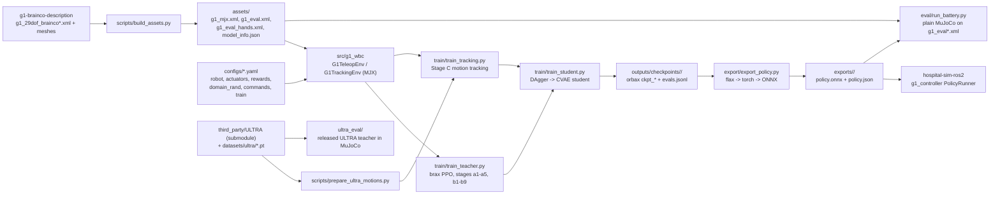

# g1-whole-body-rl: G1 whole-body teleop controller training (MJX)

This repository is the RL side of the hospital G1. It holds MuJoCo MJX environments, configuration files,
staged PPO training, teacher-to-student distillation, ONNX export and a plain-MuJoCo evaluation battery.
The target is a 29-DoF whole-body teleop controller in the style of ULTRA (see `docs/ultra_port.md`). It
reads the canonical G1 + BrainCo Revo2 MJCF and meshes from the sibling repository `g1-brainco-description`.
It writes `exports/<name>/policy.onnx` and `policy.json` for the `g1_controller` package in
`hospital-sim-ros2`. The master repository `hospital-sim` checks all of these out side by side, and
`datasets/` at the master root holds the ULTRA motion data.

Training uses the conda environment `g1-mjx`, never the master's `.venv`, and does not need `env.sh`. Paths
in this file are relative to this folder unless they name a sibling repository or the master
(`docs/interfaces.md`, `datasets/`). Commands are written to run from the master checkout root.

Status on 2026-10-10: the code is built, unit-tested and dry-run only. No training run has started. The
folder `exports/` is empty. Nothing is deployed on a real robot. The go/no-go for the first training
campaign is in the section "Training plan".

## How it works

The script `scripts/build_assets.py` reads `configs/robot.yaml` and takes the first robot source whose
files exist. The canonical source is `g1-brainco-description/g1_29dof_brainco/mjcf/g1_29dof_brainco_fixedhands.xml`;
a marked unitree_rl_gym model is the fallback. The script writes three MJCFs into `assets/`:

- `g1_mjx.xml` for training: only the 8 sole spheres and the floor collide (11 geoms).
- `g1_eval.xml` for evaluation: the source's mesh collisions (147 geoms).
- `g1_eval_hands.xml`: the full model with 22 finger hinge joints and 51 motors.

All three models get one motor per body joint, in the order of `docs/interfaces.md` section 2. Each motor
has ctrlrange = 0.8 x effort, armature and a `home` keyframe from `configs/actuators.yaml`; the timestep is
0.002 s. The script records the chosen source in `assets/PROVENANCE.md` and `assets/model_info.json`.

The file `src/g1_wbc/env.py` defines `G1TeleopEnv`, a brax `PipelineEnv` on MJX, which is the training
environment. The policy runs at 50 Hz and outputs 29 actions in [-1, 1]. At each of the 10 physics substeps
(500 Hz), the environment recomputes the joint target `q* = clip(default_pose + a * action_scale, joint limits)`.
It then applies `tau = clip(kp (q* - q) - kd qd, +-torque_limit)`; both run inside a `jax.lax.scan`. The
module `commands.py` draws per-episode STAND / LOCO / MANIP segments, velocity commands and upper-body
waypoints. The module `randomize.py` applies the ULTRA domain randomisation: friction, torso mass and CoM,
motor strength, action delay, gravity, and velocity-kick pushes.

The module `rewards.py` holds the Stage A/B reward terms; their weights are in `configs/rewards.yaml`. The
observation is a frame of 116 values (`layout.OBS_TERMS`) plus a privileged vector of 73 values for the
teacher. Episodes last 20 s (1000 steps).

The script `train/train_teacher.py` calls `ppo_teacher.train_teacher`. This function runs one
`brax.training.agents.ppo.train` per curriculum stage from `configs/train.yaml`, with 2048 parallel
environments. The curriculum `stand` has the stages a1 to a5; the curriculum `teleop` has the stages b1 to
b9. Every 5 M steps the function runs an evaluation, writes an orbax checkpoint to
`outputs/checkpoints/<run>/ckpt_<step>` and appends a line to `evals.jsonl`. A stage passes when its best
checkpoint clears the gates: velocity tracking, air time, survival and upper-body tracking. The next stage
warm-starts from that checkpoint.

The script `train/train_student.py` runs `distill_student.distill`. This is DAgger: the teacher acts on clean
observations, and a CVAE student reads a 10-frame history under ULTRA sensor noise. The script saves
`ckpt_best` when the teacher mixing coefficient, beta, reaches 0. The script `train/train_tracking.py` is
Stage C: `tracking_env.G1TrackingEnv` tracks reference motions from `data/motions/*.npz`. The script
`scripts/prepare_ultra_motions.py` makes these files from ULTRA's `[T, 630]` .pt clips (30 fps). It
resamples them to 50 Hz and recomputes the key bodies by forward kinematics on our model.

The script `export/export_policy.py` copies the student's flax parameters into a torch module layer by
layer. It checks JAX against torch on 1000 inputs. It exports ONNX opset 17 with the input `obs_history`
(float32, shape (1, 1160)) and the output `action` (shape (1, 29)). It checks onnxruntime against torch
(tolerance 1e-4) and writes `policy.json` with every key the controller reads.

The script `eval/run_battery.py` runs `sim2sim.Sim2Sim` on `assets/g1_eval.xml` in plain CPU MuJoCo. It
loads only `policy.onnx` and `policy.json`, the way `g1_controller` does. It runs 11 scenarios (2 for the
`stand` curriculum) with 50 episodes each and reports survival with 95 % Wilson intervals. With `--gate 0.9`
it exits with code 1 if any scenario is below 0.9. The controller `g1_controller` resolves
`$HG1_ROOT/g1-whole-body-rl/exports/<name>` when it runs.

## Architecture



The table lists the main pieces, their files and their roles.

| Piece | File | Role |
|---|---|---|
| Asset builder | `scripts/build_assets.py` | Source MJCF -> `assets/g1_mjx.xml`, `g1_eval.xml`, `g1_eval_hands.xml`, `model_info.json`, `PROVENANCE.md` |
| Joint layout | `src/g1_wbc/layout.py` | 29 joint names, index groups, observation terms (116) and privileged terms (73), read from `configs/actuators.yaml` |
| Config loader | `src/g1_wbc/config.py` | Loads `configs/*.yaml`, optional overlay (`stage_c_tracking.yaml`), `Stage` dataclass |
| Teleop env | `src/g1_wbc/env.py` | `G1TeleopEnv`: 50 Hz policy, 500 Hz PD, obs, termination, Stage A/B |
| Commands | `src/g1_wbc/commands.py` | STAND / LOCO / MANIP segments, cmd_vel envelope, upper-body waypoints, gait clock |
| Rewards | `src/g1_wbc/rewards.py` | Stage A/B reward terms; weights in `configs/rewards.yaml` |
| Domain rand | `src/g1_wbc/randomize.py` | ULTRA DR ranges from `configs/domain_rand.yaml` |
| Networks | `src/g1_wbc/networks.py` | Teacher actor-critic factory, CVAE student (prior, encoder, decoder) |
| Teacher trainer | `src/g1_wbc/ppo_teacher.py` | brax PPO per stage, orbax checkpoints, gates, warm starts, `evals.jsonl` |
| Gates | `src/g1_wbc/curriculum.py` | Gate metrics from brax eval metrics, do-nothing floors |
| Distillation | `src/g1_wbc/distill_student.py` | DAgger loop, ULTRA CVAE losses and schedules, `StudentJax` for inference |
| Stage C | `src/g1_wbc/tracking_env.py`, `motion_data.py` | ULTRA tracking reward and termination; .pt -> .npz -> padded JAX motion library |
| Wrappers / backend | `src/g1_wbc/wrappers.py`, `backend.py` | brax training wrappers (from the X1 port), JAX cpu/gpu selection |
| Evaluator | `src/g1_wbc/sim2sim.py`, `battery.py` | Plain-MuJoCo sim2sim from the sidecar only; scenario set; Wilson CI |
| Entry points | `train/train_teacher.py`, `train_student.py`, `train_tracking.py` | CLI for Stage A/B teacher, student distillation, Stage C teacher |
| Export | `export/export_policy.py` | flax -> torch -> ONNX + `policy.json`, parity-checked |
| Battery CLI | `eval/run_battery.py` | `--export` / `--teacher` / `--student`, `--hands`, `--gate` |
| Run script | `run.sh` | Runs any entry point in conda `g1-mjx` with the machine hygiene (section Install) |
| ULTRA baseline | `ultra_eval/` | ULTRA's released teacher on our robot, own README |

## Dependencies

The system table lists the tools of this machine with the versions as installed.

| Item | Version / note |
|---|---|
| Ubuntu | 22.04.5 LTS |
| NVIDIA driver, GPU | 580.178.04, GeForce RTX 3070 8 GB, shared with Isaac Sim. JAX is limited to 35 % of it (`XLA_PYTHON_CLIENT_MEM_FRACTION=0.35`, no preallocation; set by `run.sh`) |
| CUDA | None installed system-wide; `jax[cuda12]` wheels bring their own CUDA 12 libraries |
| conda | 25.5.0 (Miniconda at `~/miniconda3`); env `g1-mjx` = Python 3.11.16, env `ultra-sim2sim` = Python 3.10.22 (for `ultra_eval/`) |
| taskset (util-linux) | `run.sh` pins to CPUs 0-7,10-31 (logical CPUs 8 and 9 are defective on this machine) |
| git with submodules | `third_party/ULTRA` |
| ROS 2, Isaac Sim, uv, colcon, ffmpeg | Not used by this repository |

The Python table lists the packages of the conda environment `g1-mjx`, with versions from its freeze of
2026-10-10. The direct imports come from a grep over `src/ train/ export/ eval/ scripts/ tests/`: brax,
flax, jax, mujoco, numpy, onnxruntime, optax, orbax, pytest, torch and yaml. ONNX enters through
`torch.onnx.export`.

| Package | Version | Used by |
|---|---|---|
| jax, jaxlib | 0.9.2 | everything in `src/g1_wbc`; `jax-cuda12-plugin` and `jax-cuda12-pjrt` 0.9.2 for the GPU |
| mujoco | 3.10.0 | asset build, eval, env model loading |
| mujoco-mjx | 3.10.0 | `G1TeleopEnv` physics (through brax) |
| brax | 0.14.2 | `PipelineEnv`, PPO, wrappers, running statistics |
| flax | 0.12.6 | network modules (`networks.py`) |
| optax | 0.2.8 | student optimiser (`distill_student.py`) |
| orbax-checkpoint | 0.12.1 | checkpoints (`ppo_teacher.py`) |
| numpy | 2.4.6 | everywhere; must stay < 2.5 for jax 0.9.x |
| PyYAML | 6.0.3 | configs |
| onnx | 1.23.0 | ONNX export (through torch) |
| onnxruntime | 1.30.0 | export parity check, `sim2sim.OnnxPolicy` |
| torch | 2.14.0+cpu | export only, and `motion_data.load_ultra_pt`; installed from the PyTorch CPU index, not from `requirements.txt` |
| pytest | 9.1.1 | `tests/` |
| ml_collections 1.1.0, etils 1.14.0, mediapy 1.2.7, imageio-ffmpeg 0.6.0, matplotlib 3.11.2 | | not imported by this repository; kept in `requirements.txt` from the reference stack |

The file `requirements.txt` lists the same packages with `==` pins, and `environment.yml` installs it into
`g1-mjx`. The folder `ultra_eval/` has its own environment; see `ultra_eval/README.md`.

The data table lists the data and assets that are not in this git repository.

| Item | Where it comes from | Size |
|---|---|---|
| Robot model | `g1-brainco-description/g1_29dof_brainco/mjcf/` + meshes (sibling repository, cloned by the master) | in git there |
| `assets/*.xml`, `model_info.json`, `PROVENANCE.md` | generated by `scripts/build_assets.py`; committed here, regenerate after a model or `actuators.yaml` change | 140 kB |
| `third_party/ULTRA` | git submodule, github.com/Sirui-Xu/ULTRA at `ec972c7`. Code is Apache-2.0. The released teacher weights `ultra/weights/teacher_ultra_inference.pth` ship in the submodule and are for non-commercial research and education only (trained on AMASS and BONES-SEED motions; `docs/teacher-model-card.md` there) | |
| ULTRA motion data | `datasets/ultra/OMOMO_retarget_aug_v4/` at the master root: 4,066 `.pt` clips, 3.3 GB on disk, Google Drive id `1g6OzxXGJczZ4klVqKCpTzy-orKkllCr4` (ULTRA README "Data"). Git-ignored. Needed for Stage C and `ultra_eval/` | 3.3 GB |
| `data/motions/*.npz` | output of `scripts/prepare_ultra_motions.py` (empty today; Stage C has only been dry-run on `data/motions_synthetic/`) | |
| `configs/upper_body_poses.yaml` | generated by `scripts/reach_envelope.py`; committed | |
| `outputs/` | checkpoints, `bench.json`, eval JSONs, dry-run artefacts; git-ignored | |
| Trained policies | none exist. `exports/` is empty | |
| Fallback robot model | `~/ntu_dev/unitree_rl_gym/resources/robots/g1_description/g1_29dof_rev_1_0.xml`, only used if the canonical model is missing (it is not) | |

## Install

Start from a fresh clone of the master repository `hospital-sim`. The master clones `g1-whole-body-rl`,
`g1-brainco-description` and `hospital-sim-ros2` side by side. Run these commands in order from the master
root:

```bash
# 1. Get the ULTRA submodule (code and released teacher weights).
git -C g1-whole-body-rl submodule update --init third_party/ULTRA

# 2. Create the conda environment g1-mjx (Python 3.11, installs requirements.txt), pinned to the good CPUs.
(cd g1-whole-body-rl && taskset -c 0-7,10-31 conda env create -f environment.yml)

# 3. Install the torch CPU wheel (export only; not in requirements.txt, see the comment there).
taskset -c 0-7,10-31 ~/miniconda3/envs/g1-mjx/bin/pip install torch==2.14.0 --index-url https://download.pytorch.org/whl/cpu

# 4. Generate the MJCFs from g1-brainco-description, then run the tests.
g1-whole-body-rl/run.sh scripts/build_assets.py
g1-whole-body-rl/run.sh -m pytest tests -q
```

The script `run.sh` is the only supported way to run Python here. It does these things:

- It uses `~/miniconda3/envs/g1-mjx/bin/python`; the variable `G1_MJX_PYTHON` overrides this.
- It clears `LD_LIBRARY_PATH`, because a conda environment's stale libnvJitLink breaks jax CUDA.
- It runs the command under `taskset -c 0-7,10-31`.
- It sets `XLA_PYTHON_CLIENT_MEM_FRACTION=0.35`, `XLA_PYTHON_CLIENT_PREALLOCATE=false`,
  `TF_CPP_MIN_LOG_LEVEL=3` and `PYTHONPATH=src`.
- It changes into this folder, so script paths after `run.sh` are relative to this folder.

Stage C needs the ULTRA archive in `datasets/ultra/` at the master root (see Dependencies). Download it
before you run `prepare_ultra_motions.py`.

## Run

All stages can be run; none has run beyond the dry runs below. In the commands, `<best>` is the checkpoint
that `outputs/checkpoints/<run>/evals.jsonl` names as the best passing one for the last stage.

```bash
# Regenerate the assets after a g1-brainco-description or configs/actuators.yaml change; then run the tests again.
g1-whole-body-rl/run.sh scripts/build_assets.py
# Regenerate the feasible upper-body target envelope (configs/upper_body_poses.yaml), about 3000 samples.
g1-whole-body-rl/run.sh scripts/reach_envelope.py
# Measure env-step throughput per num_envs -> outputs/bench.json (about 1 min per size, including jit).
g1-whole-body-rl/run.sh scripts/bench.py --backend gpu --num_envs 1024,2048

# Stage A: stand and stabilise (deployable fallback). Prints the gate metrics every 5 M steps.
g1-whole-body-rl/run.sh train/train_teacher.py --curriculum stand --run_name stand_v1
g1-whole-body-rl/run.sh train/train_student.py --curriculum stand --teacher_ckpt outputs/checkpoints/stand_v1/<best> --run_name stand_student_v1
g1-whole-body-rl/run.sh export/export_policy.py --checkpoint outputs/checkpoints/stand_student_v1/ckpt_best --name g1_stand_v1
g1-whole-body-rl/run.sh eval/run_battery.py --export exports/g1_stand_v1 --episodes 50 --gate 0.9

# Stage B: teleop controller (b1 warm-starts from Stage A's best a-stage checkpoint).
g1-whole-body-rl/run.sh train/train_teacher.py --curriculum teleop --run_name teleop_v1 \
    --init_from outputs/checkpoints/stand_v1/<best> --start_stage b1_walk_calm
g1-whole-body-rl/run.sh eval/run_battery.py --teacher outputs/checkpoints/teleop_v1/<best>
g1-whole-body-rl/run.sh train/train_student.py --curriculum teleop --teacher_ckpt outputs/checkpoints/teleop_v1/<best> --run_name teleop_student_v1
g1-whole-body-rl/run.sh export/export_policy.py --checkpoint outputs/checkpoints/teleop_student_v1/ckpt_best --name g1_teleop_v1
g1-whole-body-rl/run.sh eval/run_battery.py --export exports/g1_teleop_v1 --gate 0.9           # add --hands for g1_eval_hands.xml

# Stage C: ULTRA motion-tracking teacher (needs datasets/ultra/OMOMO_retarget_aug_v4 at the master root).
g1-whole-body-rl/run.sh scripts/prepare_ultra_motions.py --src ../datasets/ultra/OMOMO_retarget_aug_v4 --out data/motions
g1-whole-body-rl/run.sh train/train_tracking.py --run_name track_v1
g1-whole-body-rl/run.sh train/train_student.py --curriculum tracking --overlay stage_c_tracking.yaml --teacher_ckpt outputs/checkpoints/track_v1/<best> --run_name track_student_v1
g1-whole-body-rl/run.sh scripts/build_motion_bank.py       # optional: ULTRA upper-body frames as Stage B targets

# Dry runs: the real brax training scan at tiny sizes (64 envs, 3 iterations). This is not training.
g1-whole-body-rl/run.sh train/train_teacher.py --curriculum teleop --run_name smoke --dry_run
g1-whole-body-rl/run.sh train/train_student.py --teacher_ckpt outputs/dry_run/smoke/ckpt_0 --run_name smoke_s --dry_run
g1-whole-body-rl/run.sh scripts/make_synthetic_motion.py && g1-whole-body-rl/run.sh train/train_tracking.py --run_name smoke_c --dry_run
```

For long runs, follow these steps:

1. Run detached: `nohup g1-whole-body-rl/run.sh ... > g1-whole-body-rl/outputs/<run>.log 2>&1 &`.
2. Watch `outputs/checkpoints/<run>/evals.jsonl` or the log; the gate metrics appear at every evaluation.
3. Stop the run with `kill`.
4. Resume with `--resume`; this restores the parameters, the normaliser and the stage, and Adam restarts.

Expect about 7 min of jit per stage and about 13k env steps/s at 2048 parallel environments (section
Benchmark).

## Test / check

```bash
# Run the test suite on the CPU; expect 39 passed in about 35 s.
XLA_PYTHON_CLIENT_MEM_FRACTION=0.35 g1-whole-body-rl/run.sh -m pytest tests -q
```

Expected output: `39 passed, 3 warnings` in about 35 s. The run on 2026-10-10 took 33.93 s; the warnings are
torch.onnx deprecation notices. The tests run on the CPU and cover these areas:

- `test_config.py`: config and curriculum pins.
- `test_model.py`: the generated models (joint order, sole geometry, home keyframe, ctrlrange).
- `test_env.py`: environment reset and step shapes, and the observation layout.
- `test_rewards.py`: the reward terms.
- `test_normalizer.py`: the normaliser warm start.
- `test_stage_c.py`: the Stage C data path.
- `test_export_contract.py`: the export contract. The real `g1_controller/policy.py` loads a dry-run export
  and builds the identical 116-value frame; the MJX training observation equals the CPU evaluator's
  observation.

Two other checks apply:

1. The command `g1-whole-body-rl/run.sh scripts/build_assets.py` must leave `assets/` unchanged
   (`git -C g1-whole-body-rl status`).
2. The file `assets/PROVENANCE.md` must say `robot_canonical`.

## Layout

The table lists the files and folders of this repository.

| Path | What |
|---|---|
| `run.sh` | Run script: conda `g1-mjx` python, CPU pinning, XLA 35 %, `PYTHONPATH=src` |
| `environment.yml`, `requirements.txt` | conda env `g1-mjx` definition and pinned Python deps |
| `configs/robot.yaml` | Robot model sources (canonical `g1-brainco-description`, marked fallback) and output paths |
| `configs/actuators.yaml` | Joint layout, kp/kd/armature, effort sets (`effort_source: canonical` = 35 N m ankles and waist roll/pitch; `ultra` = 50 N m), torque_limit_fraction 0.8, default pose, action scale |
| `configs/domain_rand.yaml` | ULTRA DR ranges and uniform observation noise |
| `configs/commands.yaml` | Teleop modes, cmd_vel envelope, upper-body target generator, gait clock (0.8 s) |
| `configs/rewards.yaml` | Stage A/B reward weights, kernels, termination thresholds |
| `configs/train.yaml` | PPO, networks, curricula `stand` (a1-a5) and `teleop` (b1-b9), distillation, checkpoints |
| `configs/stage_c_tracking.yaml` | Overlay for the ULTRA motion-tracking teacher (Stage C, stages c1-c2) |
| `configs/upper_body_poses.yaml` | Generated by `scripts/reach_envelope.py`: feasible teleop pose library and joint box |
| `configs/robot_profile.g1.yaml` | Profile for the `training-humanoid-rl-policies` skill's posture_ik / manifold scripts |
| `assets/` | Generated by `scripts/build_assets.py`: `g1_mjx.xml`, `g1_eval.xml`, `g1_eval_hands.xml`, `model_info.json`, `PROVENANCE.md` |
| `src/g1_wbc/` | Library (see Architecture table) |
| `scripts/` | `build_assets.py`, `bench.py`, `reach_envelope.py`, `prepare_ultra_motions.py`, `make_synthetic_motion.py`, `build_motion_bank.py` |
| `train/` | `train_teacher.py` (A/B), `train_tracking.py` (C), `train_student.py` (distil) |
| `export/export_policy.py` | flax -> torch -> ONNX + `policy.json` |
| `eval/run_battery.py` | Plain-MuJoCo battery, Wilson CIs, ONNX gate |
| `tests/` | 39 pytest tests, CPU, about 35 s |
| `data/motions_synthetic/` | 8 stub motions for the Stage C dry run; `data/motions/` = prepared ULTRA motions (empty) |
| `docs/ultra_port.md` | Where every ULTRA parameter went; deviations from ULTRA |
| `third_party/ULTRA/` | Git submodule, unmodified |
| `ultra_eval/` | ULTRA's released teacher on our robot (own README, conda env `ultra-sim2sim`) |
| `exports/<name>/` | Deployment artefacts (empty: nothing trained) |
| `outputs/` | Git-ignored: checkpoints, `bench.json`, `eval/*.json`, `dry_run/` |

## Interfaces to other repositories

This repository reads these items from its siblings and from the master.

| From | What |
|---|---|
| `g1-brainco-description` | `g1_29dof_brainco/mjcf/g1_29dof_brainco_fixedhands.xml` (train, eval), `g1_29dof_brainco.xml` (eval with hands), meshes; read by `scripts/build_assets.py` and `ultra_eval/build_ultra_robot.py` (also `g1_29dof_brainco/robot_spec.json`) |
| `hospital-sim-ros2` | `tests/test_export_contract.py` imports `g1_controller/g1_controller/policy.py` to prove that the frame layout matches |
| master `datasets/ultra/` | ULTRA `.pt` motion clips (Stage C, `ultra_eval/`) |
| master `docs/interfaces.md` | Joint order (section 2), controller modes (3.2), policy artefact contract (section 4), machine notes |

This repository provides `exports/<name>/policy.onnx` and `policy.json`, the contract of
`docs/interfaces.md` section 4. The controller (`controller_node.resolve_policy`) looks for
`$HG1_ROOT/g1-whole-body-rl/exports/<name>/policy.json` when it runs with `policy:=<name>`. It builds its
observation from the `obs` list of the sidecar only.

The sidecar that `export_policy.py` writes contains three groups of keys:

- The section 4 keys: `name`, `control_dt` 0.02, `sim_dt` 0.002, `joint_names` [29], `controlled_joints`
  [0..28], `default_qpos`, `action_scale` [29], `kp`, `kd`, `torque_limit` [29], `obs` [9 terms],
  `history_len` 10, `commands`, `placeholder` false, `action_clip` 1.0.
- Additive keys that the controller also reads: `onnx` (`file`, `input` "obs_history", `input_shape`
  [1, 1160], `output` "action", `output_shape` [1, 29], `opset` 17), `joint_limits` [29][lo, hi],
  `home_pelvis_height`, `command_details.base_height.enabled`, `gait.period_s`.
- Documentation keys: `obs_definitions`, `history`, `action_rule`, `upper_body_joint_names`, `training`,
  `robot`, `export_parity`.

The file `policy.py` does these steps:

1. It concatenates the last `history_len` frames, oldest first, and fills the history with the first frame
   on reset.
2. It feeds raw values; the normalisation is inside the ONNX graph.
3. It clips the action to +-`action_clip`.
4. It sets `q_target = default_qpos + action * action_scale` for the controlled joints and clips the result
   to `joint_limits`.

This repository publishes no ROS topics and reads none.

## Design notes

The robot is a Unitree G1 29-DoF rev 1.0 with BrainCo Revo2 hands: 33.83 kg, home pelvis height 0.784 m,
feet 0.237 m apart. The parameters come from ULTRA. The pipeline and lessons come from the
`training-humanoid-rl-policies` skill and its reference ports: H1-2 (`UnitreeH1_2_Factory/Mujoco_unitree`)
and AgiBot X1 (`AGIBOT/Mujoco_agibot`). This repository reuses their wrappers, backend and PPO driver. The
ULTRA parameter map and the nine deviations from ULTRA are in `docs/ultra_port.md`.

The file `g1_mjx.xml` keeps only the 8 sole spheres and the floor as colliders, because MJX cost scales
with the number of contact pairs. It uses the MJX-friendly solver settings that the H1-2 and X1 ports
validated: Newton, 2 iterations, pyramidal. The file `g1_eval.xml` keeps the source's mesh collisions. The
file `g1_eval_hands.xml` is the full model; its 22 finger hinge joints are interleaved in qpos, so all code
addresses joints by name. The sole geometry is identical in all three models. The ankle_pitch collision
mesh, which could touch the floor only in evaluation, was removed.

The skill's `preflight_model_check.py` reports 0 FAIL on these models.

The file `actuators.yaml` has two effort sets. The set `effort_canonical` gives the ankles and the waist
roll/pitch 35 N m, as in `g1-brainco-description` and unitree_rl_gym's rev 1.0 model. The set
`effort_ultra` gives them 50 N m. The setting `effort_source: canonical` is active, because training with
the lower authority is the conservative side. Also, `ultra_eval/` measured no difference between 35 N m and
50 N m for ULTRA's own policy.

The action scale is independent of the effort set, because it is a position range. It is 0.25 x ULTRA
effort / kp for the legs and the waist, and 3.0 rad for the arms.

The action is the same in all stages: 29 joints, `a` in [-1, 1], `q* = clip(default_qpos + a * action_scale, limits)`.
The PD loop runs at 500 Hz with `tau = clip(kp (q* - q) - kd qd, +-0.8 effort)`; the policy runs at 50 Hz.
The upper body tracks `/g1/upper_body_target` through the reward, so the controller needs no special case
per joint.

The observation frame has 116 raw values; the normalisation is in the ONNX graph. The names are those of
`g1_controller`: `base_ang_vel 3, projected_gravity 3, cmd_vel 3, cmd_base_height 1, upper_body_target_rel
17, joint_pos_rel 29, joint_vel 29, last_action 29, gait_phase 2`. The term `cmd_base_height` is optional,
default-off and always 0 so far. The gait clock is the unitree_rl_gym clock with a period of 0.8 s, the same
as the placeholder policy. The student input is 10 frames flattened oldest first, shape (1, 1160). On reset
the environment fills the history with the first frame (ULTRA convention).

The teacher has a privileged input of 73 values: every persistent DR latent plus base velocity, height and
foot contacts; the push kick is not privileged. Its observations are noise-free. It has separate actor and
critic MLPs [1024, 1024, 512] with relu. The initial per-joint exploration std is 0.165 rad / action_scale
(ULTRA's fixed sigma exp(-2.9) x 3).

The student is the ULTRA CVAE: a prior over the history, a residual posterior over the history and the clean
teacher observation, and a decoder on [s_t, z]. At deployment z is the prior mean. Training is DAgger with
ULTRA's beta schedule and the KL, prior-action and smoothness schedules. The student trains under the full
ULTRA uniform sensor noise; the labels come from the teacher on clean observations. The exported graph is
prior and decoder only: history -> action.

The module `commands.py` draws per-episode segments STAND / LOCO / MANIP with only the contract's legal
transitions (never LOCO <-> MANIP). It resamples cmd_vel every 2 s to 6 s inside the contract envelope:
vx -0.5 to 0.8, vy +-0.4, wz +-1.0 rad/s. It draws upper-body waypoints from the feasible library or box
and moves to them with min-jerk moves at <= 2 rad/s. When MANIP ends, it blends back to the default pose
over 1 s. An optional ULTRA motion-bank source is available once the data is prepared (`commands.yaml`
`p_motion_bank`).

The script `reach_envelope.py` finds 263 of 276 library poses statically feasible on the full model.
Feasible means: no new self-intersection (measured with `mj_geomDistance`), CoM margin m_hat >= 0.22, and
static gravity torques inside the clip. Both-arms-high and overhead poses are rejected because they hit the
head. The feasible joint box is 90 % collision-free (left shoulder roll >= 0.14 rad, elbow >= -0.61 rad).
The pelvis tilt the task needs is about 0 deg, against the 45.8 deg roll and 57 deg forward termination.

The Stage A/B rewards in `rewards.yaml` are additive. The reward has four groups of terms:

- Task terms from unitree_rl_gym G1: tracking_lin_vel 1.0, tracking_yaw 0.5, base_height -10, alive 0.15,
  orientation -1, lin_vel_z -2, ang_vel_xy -0.05, contact 0.18, feet_swing_height -20, contact_no_vel -0.2,
  hip_pos -1, dof_pos_limits -5.
- Teleop and stability terms: tracking_upper 1.5, torso_upright 1.0, base_acc -0.002, feet_stance 0.5.
- The ULTRA smooth pack at 1/15 of its scales: action_rate, torques, dof_vel, dof_torque_limits, energy,
  delta_dof_vel_all, delta_ang_vel_all, feet_orientation, foot_slip, feet_distance, knee_distance.
- Termination -100.

Termination happens when the pelvis is below 0.40 m, the tilt is above 0.8 rad, or the forward pitch is
above 1.0 rad.

The curricula in `train.yaml` vary one factor per stage; the tests pin them.

- Curriculum A: a1 stand calm -> a2 DR 0.5 -> a3 DR 1.0 -> a4 pushes 0.5 -> a5 pushes 1.0 (325 M steps in
  total).
- Curriculum B: b1 walk (cmd 0.5, calm) -> b2 cmd 1.0 -> b3 manip arms 0.5 -> b4 arms 1.0 -> b5 DR 0.5 ->
  b6 DR 1.0 -> b7 mode switches -> b8 pushes 0.5 -> b9 pushes 1.0 = full spec (1.2 B steps in total).

The gates are: lin-vel tracking = (do-nothing floor + 1) / 2, air time, survival (0.95 down to 0.75 by
stage), and upper-body tracking 0.6. The do-nothing floors are computed and test-pinned: b1 0.912, b2 0.751,
b3 to b6 0.822, b7 to b9 0.859. A stage passes on its best checkpoint. Warm starts reset the normaliser
dimensions that never varied.

Stage C uses `tracking_env.py` with the overlay `stage_c_tracking.yaml`; its stages are c1 (no DR, 500 M
steps) and c2 (full DR, 1 B steps). The reward is ULTRA's multiplicative tracking reward: feet key positions
p = 10, link directions r = 5, key-body velocity pv = 0.1, standing-dof stage I, sigmoid blends. This is
multiplied by exp(S/10 or S/15) with the ULTRA smooth scales. Termination follows ULTRA: root below 0.15 m;
below 0.5 m in the first 10 steps; feet deviation above 0.5 m after 30 steps. It uses a 25-frame standing
prefix, a hybrid init probability of 0.1, and 13 key bodies recomputed by FK on our model. Today it runs
only on the 8 stub motions in `data/motions_synthetic/`.

## Benchmark

The benchmark ran on the RTX 3070, shared with Isaac Sim, with XLA limited to 35 % of its memory. The
script `scripts/bench.py` measured the environment step only, on the full-spec b9 environment, and wrote
`outputs/bench.json`:

- 256 envs: 10.1k env steps/s.
- 1024 envs: 19.9k env steps/s (17.0k on a rerun).
- 2048 envs: 18.9k env steps/s.
- 4096 envs: 19.6k env steps/s.
- 8192 envs: 20.7k env steps/s.

The rate is flat from about 1024 environments. The chosen `num_envs` is 2048, which is the H1-2-validated
PPO geometry: batch 512 x 4 minibatches x unroll 20. Full PPO with the 1024-wide networks reaches about 13k
env steps/s (`train_teacher.py --ppo_bench`, differenced 16 against 4 iterations). Add about 7 min of jit
per stage.

## Dry-run proof

The dry-run artefacts are untrained and live in `outputs/dry_run/`, which is git-ignored.

- Teacher: `train_teacher.py --dry_run` ran the real brax training scan on the full-spec b9 environment
  (64 envs, 3 iterations). It printed evaluations with every gate metric, wrote checkpoints and ran the
  best-checkpoint selection.
- Student: `train_student.py --dry_run` ran 6 DAgger iterations (beta 1 -> 0). The expert loss went from
  0.21 to 0.024; the prior-action loss went from 0.042 to 0.006.
- Export: the flax -> torch -> ONNX parity was 3.1e-7 / 3.1e-7. The real `g1_controller` `PolicyRunner`
  loads the result (frame 116, input 1160). The artefact is `outputs/dry_run/exports/dryrun_UNTRAINED/`.
- Sim2sim: the battery ran from `policy.onnx` and `policy.json` only, on `g1_eval.xml` and
  `g1_eval_hands.xml`. The untrained policy falls, as it must; see `outputs/eval/dryrun_UNTRAINED*.json`.
- Stage C: `train_tracking.py --dry_run` ran the scan end to end on the stub motions.

## Training plan

The user decides go/no-go before any run starts. The table lists the proposed runs at about 13k env
steps/s.

| Run | Budget | Wall clock | Pass criteria |
|---|---|---|---|
| Stage A teacher a1-a5 | 325 M | about 7 h | survival gates 0.95 / 0.95 / 0.95 / 0.9 / 0.8 |
| Stage A student + export | about 100 M | 2 h to 3 h | ONNX battery (stand, stand_kicks 0.7 m/s) >= 90 % survival, n = 50, Wilson CI reported |
| Stage B teacher b1-b9 | 1.2 B | about 26 h | per-stage gates (tracking 0.956 / 0.875 / 0.911 / 0.929, air time, upper 0.6, survival 0.75 to 0.9) |
| Stage B student + export | about 100 M | about 3 h | ONNX battery (11 scenarios) >= 90 % survival each, stand_kicks and walk_kicks >= 80 %, student within 5 points of the teacher |
| Stage C (after data preparation) | 1.5 B | about 35 h | survival 0.8, feet error < 0.1 m |

The budgets come from the skill; the X1 needed 1 B to 2 B steps. If a run stalls, add budget first, then run
a one-factor ablation; never reduce the spec. Nothing in this table is measured yet; it is a plan.

## ULTRA's released teacher on our robot

The folder `ultra_eval/` runs the tracking teacher released with ULTRA in MuJoCo on our G1 + BrainCo, and
on ULTRA's own G1 as the baseline. Measured on 2026-10-09: it tracks as well on our robot as on ULTRA's, and
as well at 35 N m as at 50 N m. See `ultra_eval/README.md`.

## License

The license of this repository is the Apache License, Version 2.0 (see `LICENSE`).
You can use, change and share this work, also for commercial use.
If you share this work or a work that you built on it, keep the `NOTICE` file.
Give this credit in your documentation and product credits: "Based on hospital-sim by Bkrakshith (https://github.com/Bkrakshith/hospital-sim)".
To cite this work in a publication, use `CITATION.cff`.
Some third-party parts keep their own licences. The `NOTICE` file lists them.
