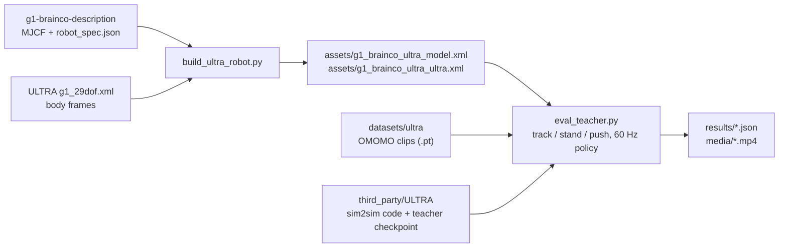

# ultra_eval: ULTRA's released teacher on our G1 + BrainCo

This folder runs the motion-tracking teacher released with [ULTRA](https://github.com/Sirui-Xu/ULTRA) in
plain MuJoCo on our robot. The weights are `third_party/ULTRA/ultra/weights/teacher_ultra_inference.pth`.
Our robot is the Unitree G1 29-DoF rev 1.0 with BrainCo Revo2 hands; ULTRA's own G1 is the baseline. No
training happens here; the folder only runs their weights, with their code, on our robot model. It needs
three inputs:

- the sibling repository `g1-brainco-description` (the robot MJCF and `g1_29dof_brainco/robot_spec.json`);
- the submodule `third_party/ULTRA` of this repository;
- the ULTRA motion clips under `datasets/ultra/` at the master root.

The master repository `hospital-sim` checks all of these out side by side. Paths in this file are relative
to `ultra_eval/` unless they begin with `../`. Commands run from the folder `g1-whole-body-rl/`, one level
up.

## How it works

The script `build_ultra_robot.py` reads `../../g1-brainco-description/g1_29dof_brainco/mjcf/g1_29dof_brainco.xml`
and `../../g1-brainco-description/g1_29dof_brainco/robot_spec.json`. It also reads ULTRA's `g1_29dof.xml`
for the frames of the 39 bodies that the policy observes. It keeps our dynamics: 33.8 kg, BrainCo hands of
0.39 kg each against 0.17 kg rubber hands, our inertias, joint limits and contact geometry. It adds only
what the policy needs to see the same observation:

- massless marker bodies with ULTRA's names at ULTRA's frames (rubber_hand, head, IMUs, camera, lidar);
- fingers without actuators, held open by 0.5 N m/rad passive springs (`--finger-curl 0..1` pre-curls them);
- ULTRA's ground plane and solver settings (PGS, 50 iterations, floor friction 2.0);
- no keyframe.

It writes two files that differ only in the body motor ctrlrange. The file `assets/g1_brainco_ultra_model.xml`
has 35 N m ankles and waist roll/pitch (this project's `effort_source: canonical`). The file
`assets/g1_brainco_ultra_ultra.xml` has 50 N m, which ULTRA trained with.

The script `eval_teacher.py` imports ULTRA's own `sim2sim_teacher.py`, `utils` and `learning` modules from
the submodule. It swaps only the robot file (`--robot ultra | ours`, `--effort model | ultra`). Everything
else is ULTRA's code and constants: the observation builder, motion and object loading, reset, the rl_games
network and checkpoint, kp and kd. The policy runs at 60 Hz with 17 PD substeps (1020 Hz) and an action
scale of 3.0. The PD torque is clipped at 0.8 x 50 N m and never exceeds the robot's ctrlrange.

The clips come from `../../datasets/ultra/OMOMO_retarget_aug_v4/*.pt` in ULTRA's `[T, 630]` format. The
option `--clips N` draws N of them with `--seed`, so every robot sees the same clips; `--clip <file>` picks
specific ones. Mode `track` follows each clip to its end, then holds the last frame for as long again. Mode
`stand` holds the first frame for `--duration` s next to the object. In mode `stand`, `--push N` applies N
horizontal pelvis pushes of `--push-force` N for 0.2 s in random directions. Clips run in `--workers`
processes.

For each clip the script records these values:

- fall (pelvis below 0.45 m, or mean body-position error above 0.5 m);
- MPBPE (the mean distance between the 39 observed bodies and the reference);
- root, joint and object errors;
- torque saturation.

It writes one JSON file (`--out`) and, with `--video`, an MP4 of the first clip, rendered with
`MUJOCO_GL=egl`.

The script `run_upstream.py` runs any ULTRA sim2sim script unchanged on a CPU-only torch; it maps every
`torch.load` to the CPU. The script `run.sh` runs a script of this folder with the `ultra-sim2sim` conda
python. It uses a clean environment (`env -i`), because conda `LD_LIBRARY_PATH` entries break imports. Set
`G1_MJX_CPUS` to a `taskset` list to pin the process to specific CPUs.

## Architecture

The diagram shows how the robot files, the motion clips and the ULTRA code come together in one evaluation.



The table gives the role of each piece.

| Piece | File | Role |
|---|---|---|
| Robot builder | `build_ultra_robot.py` | Adds ULTRA's observed bodies to our robot and writes the two evaluation MJCF files |
| Evaluator | `eval_teacher.py` | Runs the released teacher on our robot or on ULTRA's robot and records the metrics per clip |
| Upstream runner | `run_upstream.py` | Runs an unmodified ULTRA sim2sim script on a CPU-only torch |
| Run script | `run.sh` | Runs a script of this folder in the `ultra-sim2sim` conda environment with a clean environment |

## Dependencies

The system dependencies are:

- Ubuntu 22.04;
- conda with the environment `ultra-sim2sim` (Python 3.10);
- EGL for offscreen rendering (Mesa or the NVIDIA driver; `run.sh` sets `MUJOCO_GL=egl`);
- `unzip` and `gdown` for the data.

This folder uses no GPU; torch is the CPU build.

The Python table lists the packages of the conda environment `ultra-sim2sim`, with versions from its freeze
of 2026-10-10. The direct imports of this folder are mujoco, numpy, torch, imageio, and ULTRA's `rl_games`,
`learning`, `utils` and `sim2sim_teacher`. The other packages are what ULTRA's imported code needs.

| Package | Version | Used by |
|---|---|---|
| mujoco | 3.2.7 | simulation (`eval_teacher.py`, `build_ultra_robot.py`) |
| torch | 2.14.1+cpu | ULTRA network and checkpoint, `.pt` clips |
| numpy | 1.26.4 | everywhere (ULTRA's code needs numpy < 2) |
| rl-games | 1.1.4 | ULTRA's network builder and checkpoint format |
| gym | 0.26.2 | rl_games dependency |
| imageio, imageio-ffmpeg | 2.38.0, 0.6.0 | `--video` MP4 |
| trimesh | 5.1.1 | ULTRA asset code |
| scipy | 1.15.3 | ULTRA utils (rotations) |
| PyYAML | 6.0.3 | ULTRA configs |
| tqdm | 4.70.1 | ULTRA utils |
| tensorboardX, tensorboard | 2.6.5, 2.21.0 | imported by rl_games |
| gdown | 6.4.2 | data download only |

This folder has no `requirements.txt`; the pip command in Install is the full list. Do not install these
packages into `g1-mjx`, because its numpy 2.x conflicts with the numpy 1.x here.

The data table lists the data and weights that are not in git.

| Item | Where from | Size |
|---|---|---|
| `../third_party/ULTRA/` | git submodule, commit `ec972c7`, unmodified. Code Apache-2.0. The weights `ultra/weights/teacher_ultra_inference.pth` ship in it and are for non-commercial research and education (trained on AMASS and BONES-SEED motions; `docs/teacher-model-card.md` there) | |
| `../../datasets/ultra/OMOMO_retarget_aug_v4/` | ULTRA's released retargeted + augmented G1 motions, Google Drive id `1g6OzxXGJczZ4klVqKCpTzy-orKkllCr4`; 4,066 `.pt` clips, 3.3 GB extracted. Git-ignored | 3.3 GB |
| `assets/g1_brainco_ultra_{model,ultra}.xml` | generated by `build_ultra_robot.py`; committed | |
| `results/*.json`, `results/*.log` | per-clip results of the runs below; committed | |
| `media/*.mp4` | two example videos; committed | |

## Install

Run these commands in order; the first one changes into `g1-whole-body-rl/`:

```bash
cd g1-whole-body-rl
# Get the ULTRA submodule.
git submodule update --init third_party/ULTRA
# Create the conda environment.
conda create -y -n ultra-sim2sim python=3.10
# Install the torch CPU wheel.
conda run -n ultra-sim2sim pip install --index-url https://download.pytorch.org/whl/cpu torch
# Install the other packages.
conda run -n ultra-sim2sim pip install "rl-games==1.1.4" "mujoco>=3.0,<3.3" trimesh scipy tqdm "imageio[ffmpeg]" pyyaml gym tensorboardX gdown "numpy<2"
# Download the data (about 2.8 GB download, 3.3 GB extracted) into the master root.
mkdir -p ../datasets/ultra && (cd ../datasets/ultra && conda run -n ultra-sim2sim gdown 1g6OzxXGJczZ4klVqKCpTzy-orKkllCr4 && unzip OMOMO_retarget_aug_v4*.zip)
```

## Run

Run these commands from `g1-whole-body-rl/`; each comment says what the command does:

```bash
cd g1-whole-body-rl
# Write ultra_eval/assets/g1_brainco_ultra_{model,ultra}.xml.
ultra_eval/run.sh build_ultra_robot.py
# Track 100 clips with 20 worker processes: the baseline robot, then ours at 35 N m.
ultra_eval/run.sh eval_teacher.py --robot ultra --clips 100 --workers 20 --out ultra_eval/results/track_ultra_ultra.json
ultra_eval/run.sh eval_teacher.py --robot ours --effort model --clips 100 --workers 20 --out ultra_eval/results/track_ours_model.json
# Stand for 20 s with three 200 N pushes, 50 clips.
ultra_eval/run.sh eval_teacher.py --robot ours --effort model --mode stand --duration 20 --push 3 --push-force 200 \
    --clips 50 --seed 1 --workers 20 --out ultra_eval/results/stand_ours_model_push200.json
# For a video of one clip, add: --clip <file.pt> --workers 1 --video ultra_eval/media/x.mp4
# Run ULTRA's own script, unchanged.
cd third_party/ULTRA && PYTHONPATH=ultra ../../ultra_eval/run.sh run_upstream.py ultra/sim2sim_teacher.py \
    --ckpt ultra/weights/teacher_ultra_inference.pth --motion_path <clip.pt> --record_video
```

Each `eval_teacher.py` run prints one line per clip and a summary, and writes the JSON file named by
`--out`.

## Test / check

There is no test suite for this folder. Two checks apply:

1. The script `build_ultra_robot.py` must leave `assets/` unchanged (`git status`).
2. Rerun the first tracking command above with the same `--seed`. It must reproduce the survival count of
   `results/track_ultra_ultra.json` (91/100) within the Wilson interval below.

## Layout

The table lists the files and folders of this folder.

| Path | What |
|---|---|
| `build_ultra_robot.py` | Generates `assets/g1_brainco_ultra_{model,ultra}.xml`: our robot in the form the policy observes |
| `eval_teacher.py` | Batch evaluator (track / stand / push), reuses ULTRA's sim2sim code |
| `run_upstream.py` | Runs any ULTRA sim2sim script unchanged on CPU-only torch |
| `run.sh` | Runs the above in conda env `ultra-sim2sim`, clean environment, pinned CPUs, `MUJOCO_GL=egl` |
| `assets/` | Generated MJCFs |
| `results/*.json`, `*.log` | Per-clip results and logs of the 2026-10-09 runs |
| `media/*.mp4` | Example videos |
| `../third_party/ULTRA/` | ULTRA submodule, unmodified |
| `../../datasets/ultra/OMOMO_retarget_aug_v4/` | Motion clips (git-ignored) |

## Interfaces to other repositories

This folder reads these items:

- `g1-brainco-description/g1_29dof_brainco/mjcf/g1_29dof_brainco.xml` and
  `g1-brainco-description/g1_29dof_brainco/robot_spec.json`;
- ULTRA's `ultra/data/assets/g1/g1_29dof.xml` and weights;
- the clips under the master's `datasets/ultra/`.

It provides nothing to other repositories. Its results inform the effort decision in
`../configs/actuators.yaml`. The joint order is `docs/interfaces.md` section 2 in the master repository.

## The released policy

- It is the teacher only. ULTRA publishes one network: the motion-tracking teacher (a 4052-value
  observation -> 29 joint targets, 60 Hz, MLP 1024-1024-512). ULTRA has not released the deployable
  students (perception and sparse goals).
- It needs a reference motion. It reproduces a recorded human-object interaction clip. Without a clip it has
  nothing to track; "standing" means tracking a held standing frame.
- It observes privileged state: the world positions and velocities of 39 bodies and the reference. This is
  fine in simulation; a real robot would need full state estimation (mocap). Real deployment needs a
  student.
- ULTRA's MuJoCo sim2sim masks the teacher's object observation, as in 70 % of its training. So the teacher
  tracks the body motion only; box carrying is not expected to work there, on either robot.

## Results (2026-10-09)

Fall means the pelvis is below 0.45 m, or the mean body-position error is above 0.5 m. MPBPE is the mean
distance between the 39 observed bodies and the reference, over survivors only. Brackets give the 95 %
Wilson interval.

The tracking table covers 100 random clips, the same clips for every robot. The policy tracks each clip,
then holds its last frame for as long again.

| Robot | Survived | MPBPE in motion | MPBPE holding | Joint error | Object error |
|---|---|---|---|---|---|
| ULTRA's G1, rubber hands, 50 N m | 91/100 [84-95 %] | 5.8 cm | 4.2 cm | 0.066 rad | 45 cm |
| Our G1 + BrainCo, 50 N m | 88/100 [80-93 %] | 5.7 cm | 4.0 cm | 0.066 rad | 52 cm |
| Our G1 + BrainCo, 35 N m | 90/100 [83-94 %] | 5.6 cm | 3.9 cm | 0.066 rad | 51 cm |

The standing table covers 50 clips of standing still for 20 s next to the object. Each run has three 0.2 s
horizontal pelvis pushes in random directions. Push forces of 100 / 200 / 300 N give about 0.6 / 1.2 / 1.8 m/s
of velocity change for 33.8 kg.

| Robot | No push | 100 N | 200 N | 300 N |
|---|---|---|---|---|
| ULTRA's G1, rubber hands, 50 N m | 50/50 | 50/50 | 44/50 [76-94 %] | 5/50 |
| Our G1 + BrainCo, 50 N m | 50/50 | 50/50 | 46/50 [81-97 %] | 10/50 |
| Our G1 + BrainCo, 35 N m | 50/50 | 50/50 | 44/50 [76-94 %] | 6/50 |

The standing body error is 3.5 cm without pushes on all three robots; torque saturation stays below 0.3 %
of steps.

The results show these points:

- The released teacher runs on our G1 + BrainCo as well as on ULTRA's own G1: survival and tracking error
  are within each other's confidence intervals. The heavier BrainCo hands make no measurable difference.
- 35 N m against 50 N m makes no measurable difference for these motions, or for standing and pushes up to
  200 N. Peaks above 35 N m happen (ankle pitch, waist pitch) but are brief.
- It stands indefinitely. It recovers 100 N pushes every time and 200 N pushes about 90 % of the time.
  300 N pushes (about 1.8 m/s) knock it over most of the time on every robot: ULTRA trained it to track, not
  to step to recover.
- The 10 % of tracking failures are the same clips on every robot: a sim2sim gap, not our robot.
- Box carrying fails on every robot in this mode, because the object observation is masked (see above).

Two example videos show our robot at 35 N m. In `media/ours_35Nm_track_largebox.mp4` the robot crouches to
the box, tips it and stands back up: the body is tracked, the box is not carried. In
`media/ours_35Nm_stand_push200N.mp4` the robot stands, then falls after a 200 N push: one of the failures at
that level.

## Consequences for this project

- Use ULTRA's teacher as a reference or as a teacher in simulation. Two examples: check retargeted motions
  on our robot, or use it as the expert for distilling a student. Do not put it on the real robot directly.
- For standing during surgery and teleop, the plan in `../README.md` still applies: Stage A stand, Stage B
  teleop, with a deployable student and pushes in training. This test shows that our robot model and the
  35 N m limit are not a problem for ULTRA-style control.
